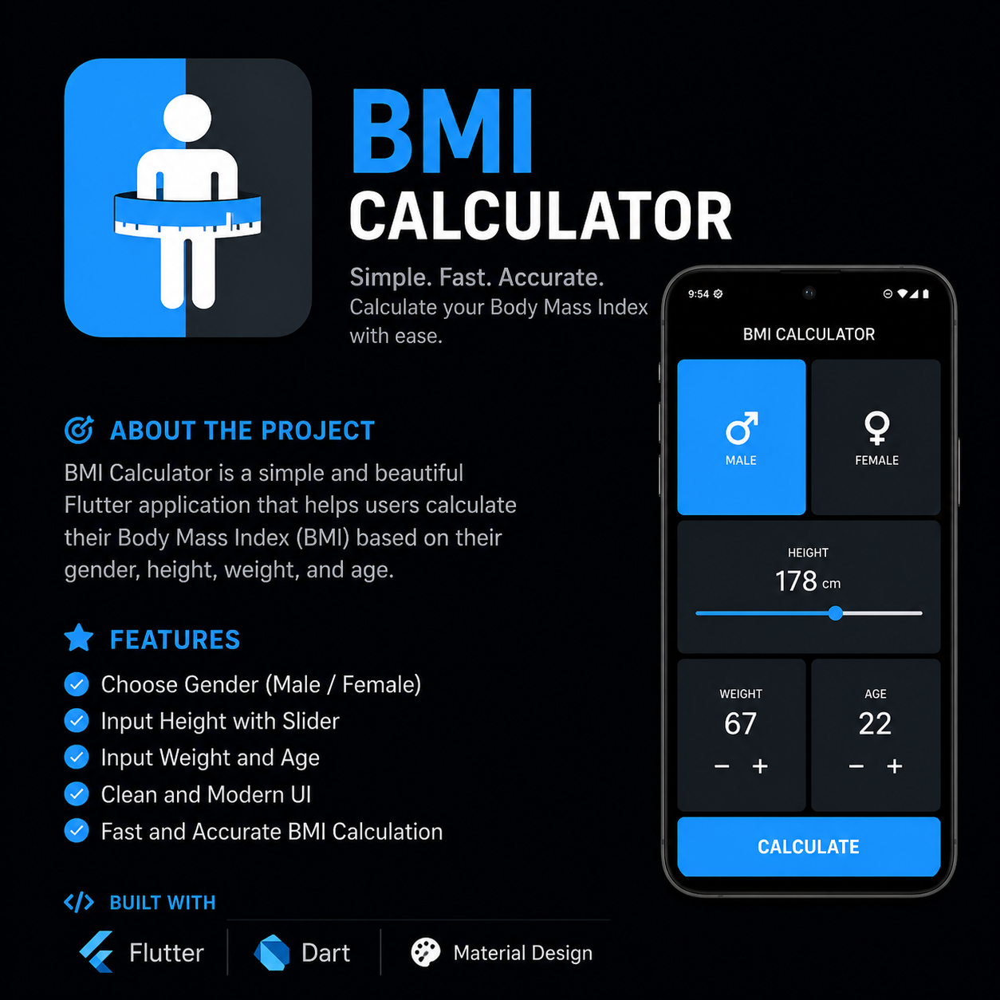

# 🧮 BMI Calculate App

  

---

## 📌 Project Idea

**BMI Calculate App** is a simple Flutter application that helps users calculate their Body Mass Index (BMI) based on their weight and height.

After entering the values, the app instantly calculates the BMI and shows the result with an easy-to-understand category (like Underweight, Normal, Overweight, etc.).

The goal of this project is to practice Flutter UI design, state management, and basic logic handling.

---

## ✨ Features

- 🧮 Instant BMI calculation  
- 🎨 Clean and simple UI  
- 📊 Shows BMI category result  
- ⚡ Fast and lightweight  
- 📱 Responsive design  

---

## 🛠️ Built With

- Flutter 💙  
- Dart 🎯  

---

## 📱 App Screenshots

  
  

---

## 📂 Project Structure
